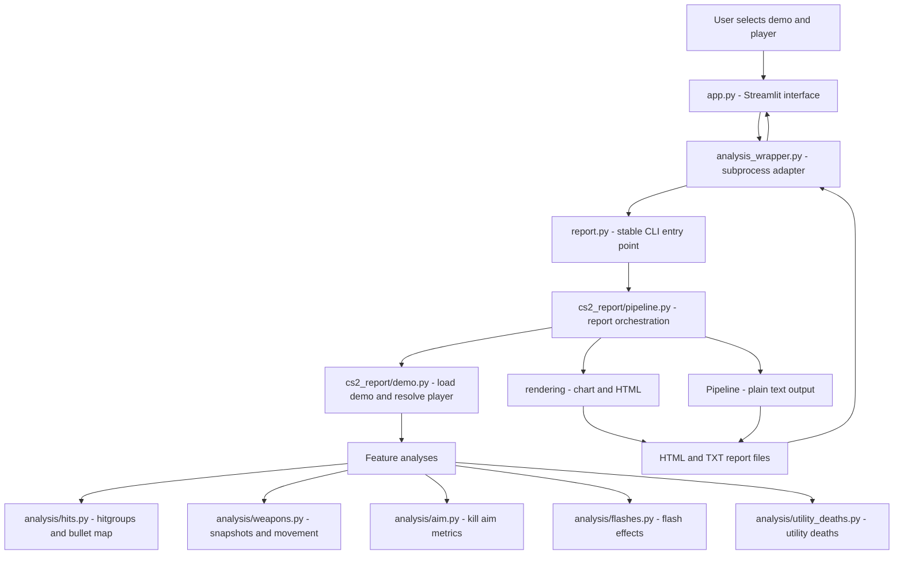

# CS2 Match Analyzer: project flow

This document maps the code from upload or command line to the generated report.

## Request flow



## Module map

| File | Responsibility |
| --- | --- |
| `app.py` | Streamlit upload, player selection, and report display. |
| `analysis_wrapper.py` | Runs the CLI as a subprocess and returns its HTML report to the UI. |
| `report.py` | Stable command line entry point used by the app and batch launcher. |
| `cs2_report/pipeline.py` | Coordinates loading, analysis, report preparation, and output files. |
| `cs2_report/constants.py` | Weapon groups, labels, body part names, and shared thresholds. |
| `cs2_report/demo.py` | Awpy demo loading and name/SteamID player resolution. |
| `cs2_report/analysis/hits.py` | Hitgroup grouping, deterministic bullet hole placement, and interactive hit map. |
| `cs2_report/analysis/weapons.py` | One snapshot query, movement speed, velocity bins, and category metrics. |
| `cs2_report/analysis/aim.py` | Aim deviation, weapon grouping, pistol kill distance, and fast-fire details. |
| `cs2_report/analysis/flashes.py` | Flash throw and blinded-player summaries. |
| `cs2_report/analysis/utility_deaths.py` | Deaths while holding utility. |
| `cs2_report/rendering/charts.py` | Plotly moving-shot velocity chart. |
| `cs2_report/rendering/html.py` and `html_v2.py` | HTML templates for Report 1.0 and 2.0. |
| `cs2_report/localization.py` | Locale catalogs, message lookup, and localized filenames. |
| `assets/human_model.svg` | Silhouette background used by the hit map. |
| `run_streamlit_app.bat` | Shortcut for launching the Streamlit interface. |

## Run the project

```powershell
python -m streamlit run app.py
```

To generate a report directly:

```powershell
python report.py --demo test.dem --player khorosiya
```

The CLI saves HTML and text reports beside the demo. Use `--report-version all` for both versions and `--locale` to select a language. The app uses temporary output files and offers an HTML download.

## Why this layout

Python packages let related code live in importable modules, while the entry point stays small. The Streamlit UI delegates report work to imported application code, keeping interface code separate from analysis. This uses a flat package layout so the existing `python report.py` and Streamlit launch commands work without installing the repository as a package. See the official guidance for [Python modules and packages](https://docs.python.org/3/tutorial/modules.html), [Streamlit best practices](https://docs.streamlit.io/develop/concepts/design/best-practices), and [src versus flat project layouts](https://packaging.python.org/en/latest/discussions/src-layout-vs-flat-layout/).
